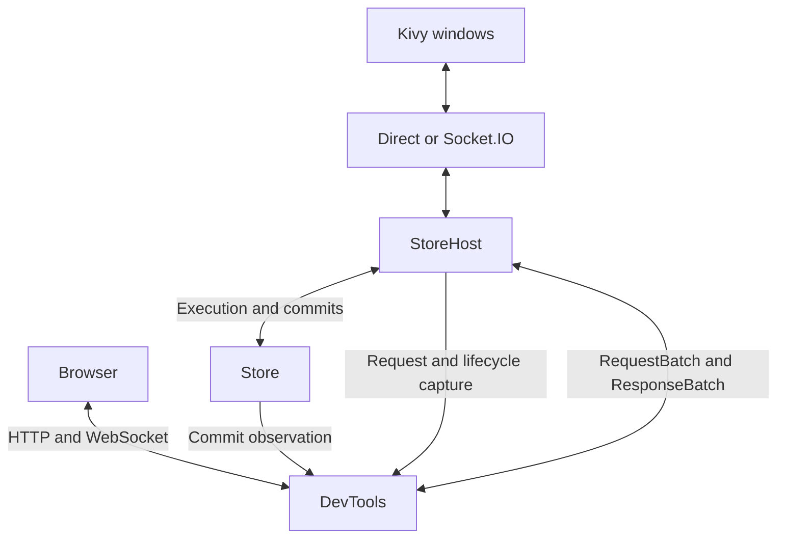

# kivyfn-store: history, undo/redo, and browser devtools

Status: revised draft; features below are not implemented by this document.
Revised: 2026-09-15, after the signal and undo/redo discussion.

This plan consolidates the agreed direction and resolves implementation details
against the current repository. All completion checkboxes start unchecked.
Complete each phase with its acceptance tests before marking it done.

The agreed direction is schema opt-in, complete transaction capture including
trigger/cascade effects, operation-level reversal, optional inverse signals,
oldest-entry eviction, and centralized devtools. The exact inverse-signal API,
normalization rules, and unsupported-effect barriers below are proposed choices
that make that direction concrete. They are not existing public APIs.

## 1. Goals and scope

Build optional browser devtools for multiprocess and multiwindow Kivy
applications, and add Store-owned undo/redo that also works without devtools.

Preserve the current application model:

- Schema defines the canonical data contract.
- Store owns data, validation, constraints, persistence, and atomic execution.
- Host and Client own requests, responses, connections, and synchronization.
- StateManager and State provide reactive state and optimistic/strict mutations.
- Existing property assignment, templates, custom State classes, queries,
  signals, and normal connection APIs continue to work.

The implementation must stay readable and proportional. Reuse RequestBatch,
ResponseBatch, transaction actions, codecs, and the existing execution path.
Keep diagnostic recording behind a small interface; do not scatter devtools
calls through fields, Nodes, compiler operations, or reactive State code.

First release scope includes inspection, activity recording, new commands,
bounded history, explicit grouping, undo/redo, and isolated historical preview.
Deliver inspection first; later phases are still part of this complete plan.

Not part of this release:

- Cloud hosting, accounts, collaboration, or a general remote administration API.
- Offline mutation queues or reconnect journal replay for application clients.
- Persisting undo history across restarts or migrating history between versions.
- Arbitrary selective undo, branching history, or editing existing history entries.
- Automatically discovering or reversing arbitrary external side effects.
  Declared compensating signals are supported; external success is not atomic
  with the Store commit.
- Cross-schema inverse-signal references, inverse payload mappers, targeted
  signal delivery, or acknowledgements from external effect handlers in v1.
- Executing arbitrary Python/JavaScript entered in the inspector.
- Replacing the application State model with a frontend state framework.

## 2. Fixed architectural decisions

| Concern | Decision |
| --- | --- |
| Repository | Keep everything in kivyfn-store with one coordinated release. |
| Frontend | React and TypeScript with the approved custom CSS theme. |
| Web server | aiohttp, already used by the existing Socket.IO transport. |
| Browser connection | HTTP for commands and reads; a plain WebSocket for live diagnostics. |
| Listener | Separate loopback listener, in the Host process and existing asyncio loop. |
| Application transport | Preserve Direct and Socket.IO behavior. |
| Browser identity | Register a browser session as a Host client, with no automatic application subscriptions. |
| Browser commands | Call the same Host request entry point used by application clients. |
| Diagnostic feed | Separate from application schema/query subscriptions. |
| History ownership | Store; independent of Host, browser connections, and Activity capture. |
| History scope | One linear history shared by all clients of one Store instance. |
| History selection | Any effective tracked operation/signal selects its complete successful transaction. |
| Restoration | Operation-owned undo/redo on private staged data, then the shared atomic commit path. |
| Triggers and cascades | Capture their finalized effects once; do not expand them again during restoration. |
| Inverse signals | Explicit declared compensation, published after canonical restoration. |
| Retention limit | Evict oldest complete entries; never reject a mutation merely because history is full. |
| Validation | Wire shape at codecs; canonical values/constraints at existing owners. |
| Packaging | Ship compiled frontend assets in the Python wheel and source distribution. |

With Socket.IO there are two listeners: the application endpoint and the
devtools endpoint. With Direct, only devtools opens a network listener.
Neither arrangement creates a second Store or a second StoreHost.



## 3. Proposed public API

Examples show the target API, not currently available functionality. Final
implementation may adjust names when needed for consistency, but must preserve
the ownership and behavior defined here.

### Schema opt-in and Store configuration

Add a reserved schema metadata attribute:

```python
class ComponentSchema(ManySchema):
    track_history = True
```

`Schema.track_history` defaults to False and is independent of `persistent`.
It follows the existing declaration inheritance rules. Validate configuration
when schemas/configuration are built, not on every mutation or in every layer.
The flag selects a transaction for history; it does not filter the transaction's
recorded effects or permanently enable tracking on another schema.

Mixed tracked/untracked foreign-key schemas are allowed in this draft. Requiring
equal flags would not account for trigger chains or application code. Complete
transaction capture plus restoration guards and final constraints protect
recorded effects and declared Store constraints. The restoration contract
does not recompute trigger results against changed untracked inputs; see
sections 4 and 5.

Add an optional `HistoryConfig` to `StoreConfig`:

```python
config = StoreConfig(
    history=HistoryConfig(max_entries=500, max_bytes=16 * 1024 * 1024)
)
```

`history=None` disables undo retention. Explicit HistoryConfig enables it for
eligible schemas. Enabling devtools must not silently enable or disable history.
The example limits are starting defaults to validate with representative data.

### Inverse signal declarations

Proposed v1 syntax uses another signal's name in the same schema:

```python
class WindowCommandsSchema(SingleSchema):
    track_history = True

    open_window = Signal[dict[str, str]](undo="close_window")
    close_window = Signal[dict[str, str]](undo="open_window")
```

Both handlers receive the same payload contract, for example a stable window ID
and application owner ID. History retains detached copies of each original and
inverse occurrence. Referencing a name avoids declaration-order and circular
import problems; do not create a second nested Signal declaration object.

- Existing `Signal()` declarations remain valid and have no automatic inverse.
- Resolve names and validate the inverse declaration once when schema metadata
  is built. Reject an undeclared/non-signal target at that ownership boundary.
- Reciprocal declarations are optional. An inverse for open_window does not
  automatically make an ordinary close_window command undoable.
- A self-inverse declaration is allowed; it is one recorded occurrence, not
  recursive inverse expansion. Whether the command is truly self-inverse is an
  application contract.
- V1 uses the original payload for compensation. Different inverse payloads,
  arbitrary mappers, and references to other schemas are deferred.
- The declaration asks Store to emit a compensating command. It does not prove
  that a window opened or closed, or that arbitrary handler effects are reversible.

Use retained schema fields when the application needs an authoritative desired
window state. A paired signal is useful for an application command whose
compensation and payload already have a clear contract.

### Client and Store history API

```python
await client.undo()
await client.redo()
history = await client.history()
```

- The no-argument convenience methods obtain a current history position and
  submit a guarded operation. They must not retry a stale position as a different
  action without the caller requesting that action again.
- Also support an explicit expected history position for a UI acting on a
  previously displayed state. Specify one typed position object rather than
  many unrelated positional parameters.
- Provide synchronous Store equivalents for callers without a Host/Client.
  They use the same history implementation and require operation identity and
  expected position for a guarded undo/redo.
- Undo/redo are strict commands. They do not add an optimistic inverse overlay.
  Existing canonical events synchronize State objects after success.
- Client completion means the command response was received. Browser display
  synchronization is separately established from its diagnostic stream.
- Expected history failures use the existing structured response/failure
  conventions; transport loss remains a separate error/ambiguous outcome.
  Readiness controls describe reachable entries, not a promise that current
  data guards cannot conflict before execution.

### Host and process API

```python
host = StoreHost(store, endpoint, devtools=True)
await host.start()
print(host.devtools_url)
```

```python
host = StoreHost(store, endpoint, devtools=DevToolsConfig(port=8766))
```

- Default: devtools=False.
- `devtools=True` uses loopback and port 0 to select an available port.
- `devtools_url` is None until the listener has started and after it stops.
- DevToolsConfig owns listener and diagnostic capture settings, not undo limits.
- StoreProcess forwards the configuration and includes the resolved URL in
  readiness data while preserving existing application endpoint fields.
- Browser opening is explicit; starting a Store must not unexpectedly launch it.

### Explicit history grouping

Add optional `history_group` and `history_label` metadata to normal transactions.
Propagate these through Client and the existing StateTransaction creation path
without changing calls that omit them.

```python
with manager.transaction(
    history_group=gesture_id, history_label="Move component"
):
    component.x = x
    component.y = y
```

Use a fresh opaque group ID for each gesture. Multiple committed transactions
can share that ID; they remain separate live commits but form one undo step.
Capture metadata when the transaction is created, before asynchronous batching.
Do not infer grouping from elapsed time, labels, or coincidentally equal values.

Keep raw pointer movement and telemetry on untracked schemas. Group actual
editable component movements by gesture. If an untracked update is intentionally
placed in the same selected transaction, its effects are recorded too; separate
items in RequestBatch remain independently selected transactions.

## 4. History records and state transitions

### What is retained

Decide eligibility from the completed effective operation list and validated
signal occurrences, before compacting data changes. If any effective operation
or signal targets a schema with track_history=True, select the whole successful
transaction. Failed transactions are never retained.

Selection includes tracked operations generated by triggers, not only caller
instructions. A tracked field can change away and back while its trigger leaves
an untracked schema changed; that transaction must still be selected. Preserve
the existing compiler rule that a true no-op field assignment is skipped before
trigger execution. Merely naming a tracked schema in a skipped request does not
turn unrelated work into tracked work.

For a selected transaction, retain all final effects:

- Direct changes, including untracked schemas explicitly changed in the batch.
- The full trigger chain and all generated cascade effects.
- Detached first-before and final-after values for changed fields.
- Full before/after rows and existence for structural changes.
- The collection order information needed to restore the recorded order.
- Every forward signal occurrence and its declared inverse, if available.
- Original transaction ID, Store instance, available origin client ID, label,
  group metadata, and an immutable history entry ID.

The current library supports CASCADE and RESTRICT. Adding SET_NULL is not part
of this feature pass; support all existing policies without inventing a new one.

Capture compiled operations and private staged values before canonical
installation. Original requests alone cannot describe defaults, generated IDs,
trigger effects, or deleted rows. Do not retain live Node/Operation references
as history records, or copy the entire Store for each entry. History owns its
record values; inspection returns detached copies. Count all retained data and
bookkeeping against the history budget.

### Normalize data effects without losing transaction ownership

Store operation-level records of the final data transformation, not a replay
script of every intermediate assignment. Coalesce repeated writes to the same
field into first-before/final-after. Preserve full rows for structural changes
and a canonical order plan for each structurally affected collection.

- If a field finishes at its original value, omit its data effect. Undo must not
  write that field and overwrite an independent later change.
- Removing and recreating an existing row may normalize into row field changes
  plus order; inserting and removing a new row may leave no data effect.
- A selected transaction with no final data/order change and no signals creates
  no entry. Signal occurrences are never removed because data became net-zero.
- Undo visits the normalized data effects in reverse order; redo visits them in
  forward order. Only the complete staged result is validated and installed.
- All guarded locations must match all locations restoration will write. Never
  replay intermediate writes while guarding only the final changed fields.
- Preserve ordinary commit events already emitted during original execution.
  Restoration emits the canonical changes it actually makes, not a replay of
  historical intermediate UI notifications.

Use the same normalization rules when merging a group. Keep original diagnostic
commits chronological in the separate recorder.

### Tracked and untracked interactions

| Execution | History behavior |
| --- | --- |
| Tracked operation changes an untracked schema through a trigger | Retain both schemas' complete final effects in one entry. |
| Untracked caller operation triggers an effective tracked operation | Select the complete transaction, including the untracked caller effect. |
| One transaction mixes tracked and untracked caller actions | Retain the complete transaction. |
| Tracked operations return to their starting values but derived effects remain | Retain the derived effects; selection happened before compaction. |
| Later independent untracked mouse/telemetry update | Create no entry; it may conflict with an older entry if their effects overlap. |
| A signal callback submits another transaction later | Apply selection separately to that new transaction. |

Do not evaluate application source code or guess asynchronous causality. A
function running later in another task/process is outside the original atomic
transaction. Use one explicit transaction for effects that must commit together.
Grouping can combine eligible commits into one undo step, but does not make
them one atomic execution or force untracked-only transactions into history.

### Linear history rules

- Undo targets the most recent applied undoable entry at the current head.
- Redo targets the next entry on the current redo branch.
- A successful selected ordinary transaction with final data/order changes or
  signal occurrences after undo discards the redo branch.
- An entirely net-zero transaction with no signals creates no entry and leaves
  redo intact. A later net-zero group cannot resurrect redo discarded by an
  earlier successful commit in that group.
- An independent untracked mutation creates no undo step and preserves redo.
- Undo/redo never skip a blocked, unavailable, or conflicting head entry.
- Undo/redo create fresh commits and operation IDs; they move the history cursor
  instead of appending recursively undoable compensation entries.
- State schema revisions continue to increase normally, once per changed schema
  per commit. They are never restored to historical numbers.
- Failed navigation leaves data, history position, and revisions unchanged,
  subject to the existing fail-closed policy for unexpected storage errors.

Maintain a monotonic history revision separate from schema revisions. It changes
when the reachable history, group contents, cursor, or barrier changes. A guarded
position contains Store instance ID, history revision, and target entry ID.
Do not introduce a global revision into normal application synchronization.

### Conflicts with intervening changes

Before restoration, compare the current values against the expected side of the
entry: after-values for undo; before-values for redo.

- Field changes guard the affected fields, preserving unrelated fields.
- Structural changes guard row existence, full relevant rows, and order.
- Records distinguish absence from an explicit None value; restoration must not
  infer existence or absence from truthiness or dict.get alone.
- A surviving row's ordinary field change requires the row to exist; it must
  never resurrect a row removed independently after recording.
- Validate the complete proposed final state, including relationships to rows
  that were not part of the original transaction.
- A structural order plan guards the full affected collection order in v1.
  Concurrent membership/order changes may conservatively conflict. Unrelated
  field-only writes on surviving rows do not conflict solely due to order.
- Reject a conflict atomically; do not overwrite newer data or silently apply a
  partial inverse. Return useful conflict details through the normal failure API.
- An unrelated schema revision change alone must not block a safe undo.

V1 uses value-based preconditions. A value changed away and back to the same
expected value may pass. This restores data; it does not prove that no intervening
user intent existed. Store-instance and history-position checks still apply.
These guarantees cover declared Store constraints and recorded effects.
Conflict guards do not guarantee that arbitrary application calculations,
including calculations performed by schema triggers, remain consistent with
changed untracked inputs. They do not infer the current state of physical/UI
effects or discover invariants implemented by external callbacks.

### Recorded trigger results and untracked inputs

Undo/redo restores recorded effects, including previous trigger results.
It does not recompute those results against current untracked inputs. This
is an accepted limitation of operation-based restoration, not an additional
conflict condition or a reason to expand the undo/redo architecture.

A later independent untracked input can change while a trigger computes the
same output. The unchanged output write is skipped by the existing no-op
rule. Undo may then restore an earlier recorded output while preserving the
newer untracked input, even though the recorded value guards all pass.

Applications requiring outputs to reflect current inputs should derive
those outputs from the current inputs instead of relying on restored
historical results. Alternatively, track independently editable dependency
inputs in the same ordered Store history, so their changes participate in
normal undo/redo order. This is application modeling guidance, not a blanket
requirement to track every schema read by a trigger. No trigger re-execution,
automatic dependency tracking, or additional validation is introduced.

Acceptance case: use separate SingleSchemas for tracked input `x`, untracked
input `z`, and untracked output `y`. Ordinary changes to either input run a
trigger that sets `y = max(x, z)`. Enable history and start at zero.

| Step | x | z | y | Expected history behavior |
| --- | ---: | ---: | ---: | --- |
| Initial state | 0 | 0 | 0 | Empty history. |
| Set x to 1 | 1 | 0 | 1 | One entry records x and its trigger effect on y. |
| Independently set z to 1 | 1 | 1 | 1 | The y write is skipped; no new entry. |
| Undo | 0 | 1 | 0 | Restore recorded x and y; leave z untouched. |
| Redo | 1 | 1 | 1 | Restore recorded x and y; leave z untouched. |

Assert successful navigation and the expected history cursor movement in
both directions, with no trigger invocation or new history entry during
undo or redo. The mismatch `y != max(x, z)` after undo is expected and must not
cause recomputation or an extra conflict rejection. This verifies the
restoration contract while preserving independent untracked changes.

### Bounds, barriers, and lifecycle

- History is bounded by entry count and retained bytes, including both signal
  payload directions, row-order metadata, and group bookkeeping.
- On successful selected work, discard redo if necessary, append/merge the
  complete entry, then evict the oldest complete entries until it fits.
  Prepare this retention change before commit and publish it only on success.
- At capacity 500, appending entry 501 drops entry 1. Its effects stay in the
  current Store; they become part of the baseline beyond which undo cannot go.
- A full history is normal operation. It must never raise a mutation failure or
  leave a partial transaction in history merely to satisfy a limit.
- Size history capture incrementally and stop retaining candidate history when
  it cannot fit; do not allocate an unbounded second copy just to discover an
  oversized entry. Ordinary canonical data/staging has its separate ownership.
  Measure the finalized normalized data effects plus all signal records, not
  the sum of intermediate assignments that normalization later removes.
- Undo/redo moves records between applied and redo positions without copying
  them into a second unbounded history. Navigation alone does not increase
  retained history or evict a step. V1 limits are fixed for the Store lifetime.
- If merging a group would exceed the byte limit, close the prior segment and
  retain the current transaction as a separate complete entry when it fits.
  Grouping is best effort under limits; one transaction is never split.
- If a single selected transaction cannot fit even by itself, commit normally
  and establish a history barrier. Clear the prior reachable undo/redo segment
  and keep bounded barrier metadata explaining the missing step.
- A barrier also covers selected transactions with unsupported compensation.
  Later entries can be undone back to that boundary, never across it. Inspecting
  older diagnostic records does not make those records undoable.
- A Store restart starts a new history instance. Host/browser reconnects to the
  same live Store do not erase its history.
- Boot recovery and migrations establish a fresh baseline. They are not user
  mutations and are not recorded as undoable actions.

### Signals, compensation, and publication

Signals currently live in StoreCommit.signals, separately from Engine
instructions and operations. Preserve that separation. A history entry combines
normalized data operation records and an ordered list of frozen signal records;
do not introduce an Engine signal executor or general effect-handler registry.

Each signal record contains its schema, optional row ID, original declaration
name, detached original payload, and resolved inverse name/payload. Resolve the
inverse during original preparation; never look up a new inverse chain or run
application command-generation logic when navigating history.

| Transaction | Result with history enabled |
| --- | --- |
| Selected data changes, no signals | Normal data undo entry. |
| Selected signal-only transaction, every signal has an applicable inverse | One undo entry even though schema revisions do not change. |
| Selected data plus applicable inverse signals | One entry containing all data and signal effects. |
| Net-zero data plus inverse signals | Keep the signal occurrences and the entry. |
| Any selected transaction includes a signal without an applicable inverse | Ordinary commit succeeds; create a history barrier for the whole transaction. |
| Untracked-only transaction, including signals | No history entry or barrier; ordinary delivery and optional Activity capture continue. |

All signals in a selected transaction participate, including signals on schemas
with track_history=False. Do not silently omit an unsupported occurrence while
offering to undo the rest of the transaction. No automatic field-level or
signal-level exclusion setting is introduced in v1.

Undo stages the normalized data inverses, then publishes the recorded inverse
signals in reverse signal order. Redo stages forward data effects, then publishes
the recorded original signals in their original order. Preserve every repeated
occurrence, even with equal payloads; do not cancel opposite signal names or
deduplicate by payload equality. Grouping preserves the full signal sequence.

In both directions, install all data, indexes, order, revisions, and history
position before publishing any callback. Preserve current State delivery: all
canonical views are updated first, then signals in commit occurrence order.
There is no interleaving with intermediate staged data just because original
request actions were interleaved. Each navigation uses a fresh transaction ID
and new commit-local occurrence ordinals, not a global occurrence counter.
Signal-only navigation advances history position/
revision but does not artificially increment schema data revisions.

Failure before installation emits no signals and moves no history cursor.
After successful installation, a publication callback failure cannot roll back
the Store commit or retract effects in another process. Keep existing callback
isolation and native Kivy binding limitations. A duplicate same-ID navigation
returns its cached outcome without republishing signals; transport loss still
has the ordinary ambiguous-outcome contract.

### Signal target lifetime and multiwindow ownership

- Preserve the current rule that a row signal needs its row in the final state.
  Validate row existence against the complete staged result before navigation.
- At recording time, an inverse row signal must be applicable to the recorded
  before-state as well as its forward counterpart to the after-state. Inserting
  a row and signaling it would remove the inverse target during undo; classify
  that selected transaction as a barrier in v1. Do not signal a tombstone or
  silently drop the occurrence.
- A target that existed on both sides but was deleted independently later
  causes a navigation conflict before any restoration or signal publication.
- For commands outliving a data row, prefer a SingleSchema signal carrying the
  window/component ID. This preserves existing signal delivery semantics.
- Signals continue to follow current schema/query subscriptions and final query
  membership. A record's origin client ID is attribution, not recipient routing.
  Undo from a browser must not implicitly target that browser or only the client
  that originally submitted the transaction.
- Multiwindow commands carry stable application-owned window and process/owner
  IDs in their payload. Subscribers implement ownership filtering and suitable
  idempotence. Ephemeral transport client IDs are not stable window identities.
- Compensation is sent to current subscribers. A disconnected original consumer
  does not receive retained signal replay after reconnect. Query filtering can
  also change the recipient set; do not promise original-recipient delivery.

Application handlers must define a meaningful compensation contract. Opening an
already-open window and then closing it is not automatically an inverse of the
original intent. State restoration and signal publication are what Store can
guarantee; OS/hardware effects and later callback-generated transactions are
outside its atomic boundary.

### Grouping rules

- Group only matching tokens from the same originating session/client.
- Merge normalized first-before/final-after data effects and order; append
  signal records without compacting their occurrence sequence.
- Before accepting a merge, recheck every signal target against the group's
  earliest before-state and final after-state. Insert-then-signal can remove an
  inverse target; signal-then-remove can remove a forward target. Close the prior
  segment and keep the current transaction separate when both are independently
  supported. Do not introduce a barrier solely because a merge is unsuitable.
- Grouped replay installs the group's complete target data before its signals;
  it does not recreate intermediate states between original transactions.
  Handlers should carry the required command context in their payloads. Do not
  group commands that require observing those intermediate canonical states.
- Independent untracked commits may occur between grouped commits.
- Another tracked group/client, overlapping untracked changes, disconnect,
  undo/redo, or a history barrier closes the current group segment.
- Track intervening write footprints: if a later grouped commit starts touching
  a location independently changed since the group began, split the group.
  Never absorb an unrelated update into the gesture's inverse.
- Reusing an old token after a segment closes starts a new entry; it cannot
  rewrite an older entry. Ending a gesture means ceasing to use its token.
- Grouping does not make separate transactions atomic. If a later transaction
  fails, earlier successful transactions remain committed and undoable.
- Compact a data-only group that becomes net-zero; retain a net-zero data group
  if it still contains signals. Never resurrect a redo branch already discarded
  by successful new work.
- Keep actual diagnostic commits chronological. Grouped undo entries cannot
  substitute for the chronological recording used by historical preview.
- Count intervening write footprints and other open-group bookkeeping against
  the history byte budget. Close the segment if that budget is exhausted; do not
  discard conflict information and continue merging.

The shared Host dispatcher passes the registered origin and grouping metadata
explicitly into Store execution. The origin is not trusted from mutation JSON.
Direct Store callers without a Host must identify a grouping owner explicitly,
or anonymous transactions must remain ungrouped.

## 5. Restoration through the existing execution architecture

Current code paths to preserve are Compiler -> Delta -> ConstraintGuard ->
Node.prepare -> FileStorage generation write -> Node.install -> Store publication.

### Operation-owned reversal

Extend the existing operation implementations with undo/redo behavior over their
finalized records. Keep record formats small and explicit; do not build a second
parallel hierarchy of generic commands, adapters, or reversible handlers.

| Recorded data effect | Undo | Redo |
| --- | --- | --- |
| Single field set | Restore before-value; return the actual SetEvent. | Restore after-value; return the actual SetEvent. |
| Collection row field set | Restore before-value in the existing row; return SetRowEvent. | Restore after-value in the existing row; return SetRowEvent. |
| Inserted row | Remove the recorded row; return RemoveEvent. | Reinsert the full recorded row; return InsertEvent. |
| Removed row | Restore the full recorded row; return InsertEvent. | Remove that row; return RemoveEvent. |
| Collection order | Apply recorded before-order after staging data effects. | Apply recorded after-order after staging data effects. |

Operations resolve the current Node by stored schema/address identity and edit
its private staged data. They do not call Node.install, publish callbacks, write
storage, run triggers, or move history independently. Event old/new values come
from the guarded actual transition. Preserve source/provenance for diagnostics
and distinguish ordinary/undo/redo at commit metadata rather than falsifying
original transaction IDs or replaying original events as new ones.

The application and browser submit only history entry/position commands through
normal requests. They never send trusted recorded operations, inverse values,
or a flag that bypasses validation. History records are internal, instance-local,
and not accepted from imported files or remote clients.

### Shared preparation, installation, and publication

1. Under the Store mutation lock and existing Engine locking discipline, check
   instance, history position, and recorded values/existence/order against
   canonical state. Build no browser-specific mutation path.
2. Call operation undo/redo on private Delta data for the complete normalized
   effect list. Prepare the selected forward/inverse signal occurrences too.
3. Check state-dependent invariants once at their existing owners: final foreign
   keys and incoming references, final unique/index state, and final signal
   target existence. Reuse ConstraintGuard and Node.prepare after adapting their
   assumptions for restoration.
4. Prepare detached event payloads, history movement/retention changes, revision
   metadata, and signal publication before the durable boundary.
5. Persist through the existing complete-generation mechanism if retained
   persistent data changed. Signal-only navigation has no data write to persist.
6. Install prepared values, indexes, order, history position, and revisions
   before any observer sees the result.
7. Publish one canonical StoreCommit through existing Host/State delivery, then
   the separate history status notification. Data and signal occurrence ordering
   follows section 4. No visible intermediate state is permitted.

Canonical recorded values already passed field validation in this Store/schema
instance. Do not route them through Compiler, rerun field validators merely to
revalidate trusted immutable history, resolve defaults again, generate fresh row
IDs, or expand triggers/cascades again. Application code must not mutate schema
metadata during the instance lifetime. Boot/migration/schema replacement starts
a fresh history baseline instead of trusting stale records.

Atomicity alone does not make old data valid against current untracked data.
Current-value guards and final state-dependent checks above are still required.
For example, an untracked row may have claimed a formerly free unique value, or
a new child may reference a parent that undo would remove. Reject the navigation
without changing data/cursor rather than creating duplicates or orphaned rows.

Apply the same reentrancy rule as Store.execute: undo/redo cannot run inside
synchronous commit delivery. Every observer must see the same completed state
and revision pair; follow-up mutations must be scheduled after delivery returns.

Refactor only the shared preparation/install steps needed for ordinary execution
and restoration to use the same invariants. Do not add an independent engine.

Two existing assumptions need explicit corrections:

- Compiler currently expands triggers and deletion policies for every normal
  instruction. Restoration applies already-expanded effects and must not run
  those transformations, defaults, or generated-ID logic again.
- ConstraintGuard currently relies on compiler expansion for CASCADE.
  Restoration must check final incoming references for all delete policies.
  A dependent added later must produce a conflict/failure, not an orphan or an
  extra unrecorded cascade.

History is a correctness component of Store execution, not a best-effort commit
observer. Prepare potentially failing history data before installing a mutation.
Treat predictable capacity/unsupported-compensation outcomes as retention
decisions, not failed mutations. Unexpected core errors keep the existing
failure policy; do not silently claim a successful reversible entry.
An unexpected failure after durable installation follows the existing fail-closed
policy; do not claim rollback after disk may already contain the new generation.
After restart, recovered canonical data is authoritative and history is empty.

### Collection order is an explicit compatibility requirement

Removing and reinserting a row currently appends it. Values alone are therefore
insufficient to restore a collection exactly. Existing snapshots also differ
from commit delivery in their callback behavior, so a forced snapshot is not an
automatic substitute for a normal undo commit.

Plan a small additive optional final `row_order` on collection/query subscription
messages, with supporting commit order metadata if needed:

- Keep existing Set/SetRow/Insert/Remove event meanings and payloads unchanged.
- Omit order metadata when ordinary event application already produces the right
  order. Preserve the old decode path when the optional field is absent.
- Include schemas changed only in order when stamping revisions, deciding whether
  to publish a commit, and checking Host commit/revision consistency. Those paths
  currently derive changes from value events; an order-only commit must not be
  suppressed or rejected because its ordinary action list is empty.
- Host query diffing must detect pure reorder as well as value/membership changes.
- StateManager applies canonical actions and final canonical order before
  publishing callbacks; pending optimistic membership/order is reconciled over it.
- MembershipDelta recognizes order-only changes, updating the rows view without
  artificial leave/enter events or replacing surviving State objects.
- Define protocol capability/version negotiation in phase 1. The new Host protocol
  requires order-aware clients and rejects incompatible sessions at registration
  with a clear reason; do not infer support from silence. Update Direct and
  Socket.IO clients together and document the coordinated upgrade requirement.
  Existing Python application calls remain unchanged.

Structural undo/redo cannot ship until canonical, collection, query, and client
callback order agree. This is the necessary additive event-envelope change to
the earlier goal of preserving ordinary mutation event semantics.

## 6. Protocol, IDs, retries, and Client integration

Extend the existing protocol and codecs with:

- HistoryRequest / HistoryResponse for bounded history pages and current status.
- UndoRequest and RedoRequest carrying a new transaction ID, expected Store
  instance/history position, and target history entry.
- Reuse TransactionResponse and TransactionFailureResponse for operation
  completion unless a concrete required return value justifies extending them.
- Optional group/label metadata on ordinary TransactionRequest.
- Optional expected Store instance and per-schema revision guards on ordinary
  TransactionRequest for browser edits based on previously displayed values.
  The shared Store mutation boundary checks these atomically before execution;
  existing unguarded application mutations keep their current semantics.
- Typed history failure codes/details for disabled, empty, stale, blocked,
  expired, and conflicting history.
- Additive commit attribution for original/undo/redo and the history entry being
  navigated. Keep existing Set/SetRow/Insert/Remove and signal event meanings.
  Inverse declarations remain server-side schema metadata, never client-supplied
  Python callables or trusted operation records.

Normal requests still travel in RequestBatch; responses still use ResponseBatch.
A batch is ordered, but multiple request items in it are not one atomic operation.
One TransactionRequest remains the atomic unit. Undo and redo are standalone
request items, not transaction actions that can be nested inside themselves.

| Identity | Owner and contract |
| --- | --- |
| Client ID | Assigned to a real registered connection/session. |
| Transaction ID | Fresh for a logical mutation/undo/redo; preserved on a retry. |
| Capture ID | Diagnostic request/response correlation; not a new core batch ID. |
| History entry ID | Immutable identity of the retained undo step. |
| History revision | Monotonic guard for history navigation and group changes. |
| Stream sequence | Diagnostic continuity only; not a schema revision. |

Extend the Host's shared completed-operation cache beyond TransactionRequest:

- Include command kind, actions, grouping metadata, edit guards, and undo/redo
  preconditions in the request fingerprint. Reusing an ID for different work is
  an error.
- Look up a cached result before applying fresh stale-position checks. A repeated
  successful undo must return its result without moving the cursor again.
- Keep logical command IDs independent of transient connection IDs so a retry
  after reconnect can be recognized by the same live Host.
- If a result has been evicted, the original guarded history position prevents
  the same undo/redo from acting on the next entry. It may then return stale,
  not a guessed success. A Store restart rejects the old instance guard.
- Do not promise durable exactly-once execution. Existing ordinary transaction
  retries remain limited by the bounded deduplication cache.

Client undo/redo use the existing batching/future/response machinery. Maintain
ordering with already queued local transactions. Reject convenience undo/redo
while earlier local mutations are unresolved, and require callers to await them;
do not guess an inverse for an optimistic state or wait indefinitely in secret.
Apply the same rule to explicit guarded navigation. Track actual queued/inflight
requests, including those whose waiting Future was cancelled. Recheck this state
before enqueueing navigation after an awaited history-status fetch.
An open unsubmitted StateTransaction is outside Client visibility and must be
closed/awaited by the caller before history navigation.

Cancellation stops waiting or delivery, not a committed operation. Surface an
ambiguous outcome on a lost response; preserve operation identity for checking
or a permitted same-ID retry. Never automatically issue a fresh-ID undo/redo or
replay browser drafts after reconnect.

## 7. Centralized devtools integration

Add a small DevTools facade with explicit capture methods:

```python
capture = devtools.request(client_id, request_batch)
devtools.response(capture, response_batch)
devtools.event(commit)
```

The facade owns the recorder and DevToolsServer. Capture methods do not execute
commands. Browser handlers call Host.request to submit commands.

Central integration points:

1. Host request entry/completion: capture existing typed batches.
2. Store.subscribe_commits: attach `devtools.event` during startup and detach
   during cleanup. Store does not import devtools to publish a commit.
3. Host connect/disconnect: report client lifecycle at those existing boundaries.

Store also exposes a small history-status observer. Attach it alongside the
commit observer so cursor/group/barrier changes without a canonical value commit
still update browser controls. This is a Store history API, not a devtools call
inside Store. History notification failures have the same observer isolation as
normal commit notification failures.

If a Host request raises/cancels without producing ResponseBatch, finalize its
capture as failed/cancelled without fabricating a protocol response or claiming
that an already committed transaction failed. Response capture means a response
was produced, not that a remote peer definitely received it.

Malformed application transport input can fail before Host.request. Where that
activity is displayed, the transport reports a small failure description to a
central Host hook; it does not import devtools or invent a valid RequestBatch.
Do not instrument individual fields, constraints, or compiler operations.

A well-formed request for a schema absent from the built Store is an ordinary
rejection. Preserve the corrected subscription behavior: capture the failure,
keep the Client online, and leave unrelated subscriptions usable. Do not
reclassify it as malformed transport input while adding diagnostic hooks.

Inside devtools:

- Filter before retaining expensive high-rate payloads.
- Own detached captured values; frozen envelopes alone do not freeze nested data.
- Record a canonical StoreCommit once, not once per application subscriber.
- Keep recording limits separate from history limits and per-browser buffers.
- Contain recorder/serialization/browser exceptions so diagnostics cannot turn
  a successful Store mutation into an application failure.
- Do no network I/O from a synchronous Store commit callback. Bound retained data
  and scheduled work; cross-thread handoff must also be bounded.
- Release completed capture correlation records and bound pending captures.

No recursive instrumentation of the diagnostic feed itself. Browser commands
are captured once by the normal Host hooks. Diagnostic filter/read controls do
not generate an endless stream of self-recorded Activity messages.

## 8. Browser sessions and Host client routing

Register browser sessions as Host clients with their own client IDs. This adds
connection identity, not ordinary schema/query subscriptions.

Refactor the existing Host client record to own its event-send and connection-
close callbacks. Today HostClients and failure cleanup assume self.transport
owns every connection. Both paths must use the registered connection owner.
Avoid a general multi-transport manager or adapter registry for this change.

- Direct and Socket.IO register their existing delivery/close functions.
- A devtools WebSocket establishes a server-issued browser session. HTTP commands
  are associated with that session, not a caller-supplied arbitrary client ID.
- Devtools calls the existing Host.request with RequestBatch and returns its
  ResponseBatch over HTTP. Support normal transactions, one-shot queries, and
  history commands. Reject application subscription/unsubscribe request types at
  the devtools server boundary as well as omitting them from the v1 UI.
- Serialize commands and disconnect for a browser session, as Socket.IO currently
  serializes requests against connection closure.
- Duplicate live client IDs with different owners must be rejected.
- Browser close unregisters its Host client and diagnostic stream resources.
- Two tabs receive distinct session IDs. Reconnect may create a new session while
  an unresolved logical transaction retains its transaction ID.

Host flush guarantees apply to its normal application event queues. They do not
mean that the independent browser diagnostic stream has caught up.

## 9. DevToolsServer, inspection, and synchronization

### Listener and lifecycle

Use an aiohttp Application with AppRunner/TCPSite in the existing asyncio loop.
The server owns routes, sessions, WebSocket writers, and cleanup. No nested
asyncio.run(), second event loop, background server process, Flask, or FastAPI.

- Host owns startup/stop and exposes the resolved URL after successful startup.
- Partial startup unwinds both listeners, callbacks, sessions, and tasks.
- Explicit enablement with a bind/asset failure produces a clear startup error;
  it must not silently announce working devtools.
- Runtime failure of a browser or recorder disables/cleans that diagnostic
  component while ordinary Store operation continues.
- Stop accepting browser commands before unregistering its sessions. Await or
  cancel owned tasks deliberately and observe their outcomes.
- A cancelled stop waiter must not interrupt the underlying cleanup.

Use one loopback origin for packaged assets and API. At this real trust boundary,
check Host/Origin and bind commands to the established session; reject unexpected
cross-origin access and arbitrary claimed identities. Bound request bodies and
filters. Serve only packaged assets with no directory listing or path escape.
V1 remains local-only; broad remote authorization is outside this plan.
Render captured values as inert content, not executable markup. Define lossless
handling for wire values outside JavaScript's safe numeric range; do not silently
round a Python integer during display, editing, or copying a mutation. Unsupported
editable representations must be identified explicitly rather than corrupted.

Suggested endpoints:

| Endpoint | Purpose |
| --- | --- |
| GET / and /assets/... | Packaged React application. |
| GET /api/info | Protocol version, capabilities, Store identity, schema catalog. |
| POST /api/commands | Existing request codec, Host.request, existing response codec. |
| GET /stream | Browser session plus diagnostic snapshot/activity stream. |

Inspection controls can use a small diagnostic envelope. They are not a second
implementation of Store transactions or queries. Keep routes in server.py until
a concrete readability reason warrants separating them.

### Read-only Store inspection APIs

The current Store has per-schema snapshots and revisions, but lacks a detached
browser-ready schema catalog and an atomic multi-schema checkpoint operation.

Add narrowly scoped Store read APIs for:

- Schema names and kind; fields, nullability, supported enum/default metadata,
  relationships, signal declarations and inverse names, persistence, and history
  policy. Expose inverse names as metadata, not new browser-defined handlers.
- A selected set of schema snapshots with their revisions captured together.
- An atomic checkpoint-plus-observer registration boundary, with unsubscribe
  ownership, so changes cannot fall between snapshot and stream attachment.

Do not serialize Python field objects, validators, trigger functions, or arbitrary
application callables. Devtools must not reach into Store._engine or mutate Nodes.

The State tab shows canonical Store data. Client-local Kivy properties, pending
overlays, and per-window State objects are not visible without separate client
instrumentation; do not imply that this first release inspects them.

### Diagnostic stream contract

- Identify the Store instance, diagnostic session/epoch, and ordered stream
  sequence. Activity can occur without a Store revision change.
- Deliver an initial selected-scope snapshot, then subsequent committed changes
  in order. Capture/registration is atomic; do not stitch together unrelated reads.
- Filtering a stream must not masquerade as dropped data: sequence delivered
  envelopes consecutively or explicitly describe filtered ranges.
- Changing the viewed schema/scope establishes a new snapshot boundary.
- Reconnect replaces stale live views with a fresh checkpoint. A changed Store
  instance invalidates old positions and previews.
- On queue overflow, announce a gap and resynchronize state, or close the stream
  if even that marker cannot be delivered. Activity displays a loss marker.
- Bound record count, retained bytes, browser queue bytes, and oversized payloads.
  Any truncation must be visible; truncated data is not a valid replay delta.
- HTTP responses and WebSocket updates can arrive in either order. Correlate
  transactions and revisions without applying the same mutation twice.

Activity capture pause and UI display pause are distinct. Pausing Activity
recording or changing Activity filters does not pause undo retention, the
browser's live State feed, or live application synchronization.

## 10. Historical preview and browser behavior

Preserve the approved theme: violet accents, neutral surfaces, compact type,
navigation/undo controls above a selectable list and a details panel. Adapt the
layout for smaller browser windows; do not replace it with a generic admin theme.

### State view

- Schema navigation, row IDs, canonical values, revisions, and connection state.
- Explain tracked/untracked status and empty/nullable relationships clearly.
- Editing opens a new mutation draft. Apply submits a new transaction.
- Preserve an unfinished draft while live values change; identify changes to its
  source instead of silently replacing the user's text.
- Browser drafts carry the displayed Store instance and relevant schema revisions
  as transaction guards. A separate HTTP preflight read is not atomic. A changed
  schema may conservatively conflict even when a different field changed; show
  the refreshed value and let the user submit a new intent explicitly. Keep
  unguarded existing application writes unchanged.

### History view

- Immutable entries with before/after values, origin, grouping, and status.
- Show normalized data effects alongside the forward/inverse signal occurrences.
  Distinguish an original transaction from an undo/redo commit in Activity.
- Undo last / Redo next act on the guarded history head, not the selected row.
- Selecting an old entry changes details only.
- Show disabled reasons: empty, unavailable, barrier, conflict, or stale history.
- Show why an entry is unavailable, such as no declared inverse, an inverse row
  target absent from the before-state, or an oversized transaction. Show the
  retained oldest boundary when history eviction advances it. Do not describe
  a compensating signal as confirmation of an external action's success.
- Copy as new mutation creates a fresh editable request with a fresh transaction
  ID. It never edits the original record or reuses its execution identity.

### Activity view

- Requests/responses, failures, commits, signals, queries, subscriptions,
  connection lifecycle, and diagnostic gaps.
- Filter by client, schema, category, status, and transaction/capture identity.
- Show captured request/response details and timing with clear produced/delivered
  semantics. Do not present transport delivery as proven when only captured.
- Run query again submits a new live QueryRequest; a historical query response
  remains a record of what was returned then.
- Signals can be emitted as new declared actions. Eligible compensated signals
  participate in Store history under the same rules as application commands;
  Activity still shows every captured occurrence, including untracked signals.
- Sampling/coalescing is allowed for live display, never silently for a recording
  that claims exact historical reconstruction.

### Isolated preview

Historical preview reconstructs captured data in detached memory. It never moves
the live Store, invokes triggers, emits signals, or executes original requests.

- Retain a bounded checkpoint plus chronological complete deltas for an explicit
  captured scope. Account for checkpoints and deltas in the diagnostic budget.
- If a scope change, eviction, pause, truncation, or gap breaks continuity, start a
  new checkpoint or mark affected time ranges unavailable.
- Grouped undo entries are not a complete chronological recording. In particular,
  untracked changes may occur between the grouped transactions.
- Historical values outside the captured scope are unavailable, not current live
  values disguised as historical data.
- Show a persistent preview banner and Return to live action. Disable mutation,
  signal, undo/redo, and copy-as-new submission controls in preview mode.
- Live updates may continue into a separate live cache; never overwrite the
  preview or apply historical deltas to that live cache.
- V1 previews captured schema data and captured query responses. Evaluating new
  historical joins/queries requires complete dependency snapshots and a detached
  executor; leave that capability unavailable rather than query the live Store.

## 11. Repository and file responsibilities

Start with the following files; do not create empty abstraction layers in advance.

| Path | Responsibility |
| --- | --- |
| src/kivyfn/store/store/history.py | History records, normalization, cursor, groups, limits, restore preconditions, and recorded signal compensation. |
| src/kivyfn/store/core/operations.py | Existing operation staging plus undo/redo of finalized data records; no publication or persistence. |
| src/kivyfn/store/schema/signal.py | Optional inverse-name metadata, preserving existing Signal declarations. |
| src/kivyfn/store/devtools/__init__.py | Public configuration exports. |
| src/kivyfn/store/devtools/config.py | Immutable listener and diagnostic settings. |
| src/kivyfn/store/devtools/devtools.py | Small facade connecting capture, recorder, and server lifecycle. |
| src/kivyfn/store/devtools/server.py | aiohttp routes, browser sessions, writers, and cleanup. |
| src/kivyfn/store/devtools/recorder.py | Bounded activity/commit capture and preview checkpoints. |
| src/kivyfn/store/devtools/protocol.py | Diagnostic envelopes, inspection serialization, and versioning. |
| src/kivyfn/store/devtools/static/ | Generated assets included in release packages. |
| devtools/frontend/ | React source, manifest, lockfile, TypeScript and build configuration. |
| devtools/frontend/src/api.ts | HTTP commands, session association, live stream and reconnect. |
| devtools/frontend/src/types.ts | Diagnostic and reused request/response wire types. |
| devtools/frontend/src/App.tsx | Layout and shared UI state. |
| devtools/frontend/src/views/ | State, History, and Activity views. |
| devtools/frontend/src/components/ | Shared inspectors, details, drafts, and controls. |
| devtools/frontend/src/theme.css | Approved theme and responsive layout. |
| tests/devtools/ | Capture, server, sessions, synchronization and lifecycle tests. |
| tests/store/test_history.py | Store history invariants. |
| tests/integration/test_history.py | Full history flow through both application transports. |
| devtools/frontend/tests/ | Browser integration tests; small unit tests may be colocated. |
| scripts/build_release.py | Frontend build and Python release packaging orchestration. |
| docs/history.md and docs/devtools.md | Public contracts, examples, limits, and troubleshooting. |

Existing modules expected to change:

- schema/schema.py, schema/signal.py, and builder/config.py for track_history,
  inverse declaration resolution, and HistoryConfig alongside StoreConfig.
- store/store.py for history integration and detached inspection APIs.
- store/instructions.py for shared signal-target validation; signals stay at
  the Store layer instead of becoming compiler instructions.
- core/operations.py, core/execution.py, core/engine.py, core/constraintguard.py,
  and relevant Delta/Node preparation code for operation-owned restoration/order.
  Compiler may expose existing execution provenance where needed; it must not
  gain devtools dependencies or repeat trigger expansion during navigation.
- protocol/message, codec/requests.py, codec/responses.py, and codec/events.py for
  additive commands, metadata, failures, and order-aware delivery.
- host/host.py, host/client.py, and host/request.py for client ownership, shared
  request handling, capture, deduplication, and lifecycle.
- host/query.py and host/subscription.py for order-aware result delivery.
- transport/direct and transport/socketio only where registration/cleanup or
  boundary error reporting needs to use the new Host connection ownership.
- client/client.py and narrowly scoped State transaction/collection/query code
  for new commands, grouping metadata, and canonical order reconciliation.
- process.py for configuration forwarding and readiness information.
- pyproject.toml and release configuration for package data and validation tools.

Do not refactor unrelated schema, query, typing, or reactive APIs while adding
these capabilities. Fix additional correctness problems exposed by relevant
tests and document why each change is necessary.

## 12. Frontend tooling and Python packaging

Use a small React/TypeScript application and a standard frontend build tool
(Vite is a suitable starting choice). Use custom CSS and avoid adding a separate
frontend state library until application complexity demonstrates a need.

- package.json owns frontend dependencies and build/typecheck/test/lint scripts.
- Commit the frontend lockfile. Install reproducibly with the chosen package
  manager in development and CI.
- pyproject.toml retains Python metadata, dependencies, pytest/Pyright/Ruff
  configuration, and setuptools package-data declarations.
- Keep setuptools; rebuilding the frontend does not require replacing the Python
  packaging backend. Add a small release orchestrator rather than a framework.
- Build the frontend before the Python distributions, copy fresh output into
  package static assets, and include it in both wheel and sdist.
- Resolve installed assets as package resources, not relative to the shell's
  working directory. Keep package discovery from treating asset folders as code.
- Builds must fail clearly if required frontend output is missing or stale.
- Published wheel/sdist installs must not run npm, require Node, or fetch browser
  assets from a CDN. React and other required browser assets are bundled.
- A published sdist builds its wheel using those bundled assets. Frontend rebuild
  and source-freshness checks belong to release preparation, not ordinary sdist
  installation. Validate that bundled files exist without invoking npm.
- Developers changing only Python can use matching prebuilt assets obtained from
  a release via a documented helper, or perform one frontend build. A fresh source
  checkout has no generated assets; state that requirement explicitly. Frontend
  developers need Node and the frontend tools. Document both workflows.
- Pyright/Ruff validate Python; TypeScript and frontend lint/format tools validate
  the web code. Provide one documented command to run both sets of checks.
- Keep node_modules, caches, dist/build output, and generated assets out of normal
  source commits; explicitly include required prebuilt assets in release archives.
- Installation extras control dependencies, not which static files are present.
  Devtools activation is a runtime option; an extra is unnecessary unless new
  optional Python dependencies are actually introduced.

Use normal Python/KV formatting with 79-character code lines. Preserve the
repository's configured formatting rules and existing public type checks.

## 13. Implementation phases and acceptance gates

### Phase 1: contracts and Host connection ownership

- [ ] Finalize typed history positions, command IDs, failure details, grouping,
  inverse-signal declarations, normalized operation records, order metadata,
  and diagnostic envelope version.
- [ ] Move delivery/close callbacks to each registered Host client.
- [ ] Preserve Direct/Socket.IO request ordering, disconnect, and cleanup behavior.
- [ ] Add central optional request/response/lifecycle capture hooks.
- [ ] Add detached schema catalog, history-status observation, and atomic
  checkpoint/observer APIs.
- [ ] Run existing tests plus focused multi-owner and snapshot-race tests.

Gate: enabling no devtools changes no existing application behavior; browser-style
sessions can use the same request dispatcher without misrouted cleanup.

### Phase 2: devtools inspection and live Activity

- [ ] Implement facade, bounded recorder, separate aiohttp listener, and sessions.
- [ ] Implement real State/Activity views with the approved theme.
- [ ] Implement snapshot continuity, filtering, gaps, reconnect and startup/stop.
- [ ] Forward configuration/readiness through StoreProcess.
- [ ] Package and smoke-test the first functional inspection build.

Gate: real application clients over Direct and Socket.IO can be inspected;
diagnostic failures and slow browser connections do not corrupt application state.

### Phase 3: browser commands

- [ ] Route mutations, declared signals, and one-shot queries through RequestBatch.
- [ ] Return ResponseBatch and correlate acknowledgements with live commits.
- [ ] Implement mutation drafts, guarded edits, failure display, and same-ID retry
  handling for ambiguous outcomes within the supported cache window.
- [ ] Test attribution, session ownership, stale edits, interleaving and cancellation.

Gate: browser writes have the same validation, triggers, persistence and event
effects as normal clients. No browser-specific mutation executor exists.

### Phase 4: Store history and complete restoration

- [ ] Add schema opt-in, HistoryConfig, detached entries, bounds and barriers.
- [ ] Select before compaction and record complete finalized transaction effects.
- [ ] Implement normalized operation records and operation-owned undo/redo.
- [ ] Use shared final constraints/index preparation, persistence, installation,
  and publication without repeating compiler/trigger/default expansion.
- [ ] Correct final incoming relationship checks for restoration.
- [ ] Verify the recorded-trigger-results acceptance case in section 4:
  restore recorded effects, preserve the independent untracked input, and
  do not recompute or reject the accepted calculation mismatch.
- [ ] Add inverse signal declarations and complete forward/inverse occurrence
  capture, target lifetime checks, publication ordering, and unsupported barriers.
- [ ] Implement oldest complete-entry eviction and oversized transaction/group
  handling; capacity must never reject the ordinary mutation.
- [ ] Implement canonical order metadata and order-aware State/query delivery.
- [ ] Add grouping and all untracked/interleaving/structural conflict rules.
- [ ] Inject persistence failures before and after each relevant durable boundary.

Gate: synchronous Store undo/redo is correct for supported CRUD, grouping,
relationships, constraints, order, declared signal compensation, and failure
boundaries before exposing UI controls.

### Phase 5: protocol and application undo/redo

- [ ] Add history/status/undo/redo requests, responses, codecs and typed failures.
- [ ] Extend shared deduplication and Client future/batching/response handling.
- [ ] Add Client APIs and transaction group metadata propagation.
- [ ] Verify two-client stale positions and duplicate requests across reconnect.
- [ ] Verify normal canonical events synchronize every affected State and Query.
- [ ] Verify compensated signals across current subscribers, stable application
  ownership filtering, same-ID retry, cancelled waiters, and disconnected origins.

Gate: await client.undo()/redo() works with devtools disabled over both Direct and
Socket.IO, with no duplicate execution or optimistic-state corruption.

### Phase 6: History UI and historical preview

- [ ] Connect head-based controls, immutable entries, grouped diffs and barriers.
- [ ] Show recorded inverse signals, compensation limits, oldest retained boundary,
  and barrier reasons without permitting edits to stored history records.
- [ ] Implement bounded chronological checkpoint/delta preview recording.
- [ ] Implement isolated preview, unavailable ranges, and Return to live.
- [ ] Add Copy as new mutation and live query rerun controls where supported.
- [ ] Test live updates during preview/drafting and all disabled-control states.

Gate: preview never changes live Store data; undo/redo operates on guarded current
history and every unavailable historical value is represented honestly.

### Phase 7: complete verification and release

- [ ] Complete the coverage matrix below, including newly discovered edge cases.
- [ ] Run the full pytest suite, Pyright, Ruff lint and Ruff formatting checks.
- [ ] Run those release checks with the actual kivyfn and kivy-stubs dependencies;
  a reduced typing probe or logger substitute is not release verification.
- [ ] Run frontend typecheck, lint, formatting, unit and browser tests.
- [ ] Build wheel and sdist from a clean checkout and install both without Node.
- [ ] Fetch real installed assets and exercise browser commands and a live stream.
- [ ] Update README/docs and record compatibility changes and actual check results.

Gate: no feature is called complete based only on a mockup, unit tests, or the
number of tests. Record concrete invariants tested and any deliberate limitations.

## 14. Required coverage matrix

Use deterministic barriers/events and controlled writers to exercise ordering.
Use injected storage failures instead of relying on timing or actual crashes.
Every test must protect a contract; do not duplicate implementation steps merely
to increase the count. Investigate and fix additional bugs uncovered by testing.

| Area | Required cases |
| --- | --- |
| Schema/config | Default off, opt-in inheritance, reserved names, persistence independence, mixed FK tracking flags, invalid configuration at its owner. |
| Retention | Effective tracked participation before compaction, true no-op filtering, failed transactions, complete mixed-schema effects, count/byte bounds, oldest whole-entry eviction, oversized entry barriers, bounded candidate capture. |
| Operation records | Coalesced repeated writes, tracked net-zero roots with untracked derived effects, insert-remove, remove-reinsert, final order, guarded footprint equals actual restoration writes, no retained live Node/Operation objects. |
| Values/ownership | Mutable nested values, caller mutation after submission, capture/preview ownership, exact large integers and supported wire types. |
| CRUD | Single and row sets, insert/delete, repeated writes, insert-remove, remove-reinsert same ID, empty collections, structural order. |
| Constraints | Unique swaps and intervening unique claims, nullable/non-nullable FKs, restrictions, cascades, nested relationships, new incoming dependents under every supported policy. |
| Triggers | Tracked-to-untracked and untracked-to-tracked chains, complete derived capture, no second expansion/defaults/IDs, final state constraints without repeated static value validation, section 4 acceptance case restoring recorded trigger results while preserving an independent untracked input after an unchanged output write was skipped. |
| Signal declarations | Default no inverse, missing/non-signal target, unilateral/reciprocal/self-inverse declarations, inheritance, same payload contract, no recursive inverse lookup. |
| Signal retention | Tracked signal-only entries, mixed tracked/untracked effects, paired/unpaired barriers, repeated equal signals, detached nested payloads, data net-zero with nonempty signal sequence, both payload directions within byte limit. |
| Signal execution | Forward and reverse ordering, final state visible before callbacks, no signals on precommit failure, callback errors after commit, no re-emission on same-ID retry. |
| Signal targets/routing | Insert-and-signal barrier, independently deleted row conflict, restored live targets, final query membership, schema/query fan-out, multiple clients, disconnected origin, stable owner filtering, no reconnect replay. |
| Grouping | Multiple commits, late failure, data-only net-zero, retained signals, clients/token reuse, independent telemetry, newly overlapping fields, bounded footprint bookkeeping, oversized merge splitting without splitting a transaction, insert-then-signal/signal-then-remove merge rejection, same-ID remove/reinsert, whole-group final state before signals. |
| History conflicts | Stale cursor, changed values/rows/order, unrelated changes, value-away-and-back policy, unavailable head, no skipping. |
| Persistence/boot | Write/replace/install failures, undo and redo failure, mixed persistent/transient effects, restart after durable change, migration baseline. |
| Revisions/events | Fresh navigation/occurrence IDs, monotonic data revisions, order-only commits, signal-only history movement with no data revision increment, history-only notifications, final state before callbacks, rejected reentrant undo, callback failures. |
| State | Strict and optimistic operations, pending overlays during foreign-client undo, rollback, stable row identity, custom State local properties. |
| Transactions | Open/local pending work, cancelled waiters with inflight requests, status-fetch races, overlapping participants, partial batches, metadata ownership, later callback-generated work as a separate transaction. |
| Collections/queries | Membership enter/leave, order-only changes, joins/aliases/null relationships, filter transitions, projected writes, query shape identity. |
| Protocol | Round trips, malformed real-boundary input, wrong response ID/type, reused ID with changed metadata, optional-order compatibility. |
| Direct and Socket.IO | Same history command invariants on both paths; application clients alongside a real browser session; no delivery to wrong owner. |
| Host lifecycle | Two connection owners, duplicate IDs, startup failure, repeated start/stop, disconnect during request, cancellation-safe cleanup. |
| Browser sessions | Distinct tabs, HTTP session ownership, closed/spoofed sessions, origins, rejected subscription commands, inert rendering, request limits. |
| Retry/ambiguity | Lost reply after commit, same-ID retry, changed retry payload, cache eviction, Store restart, no blind fresh-ID resubmission. |
| Capture | Read/failure/lifecycle coverage, one record per commit, browser command recorded once, pause/filter behavior, failures before decoding, missing-schema subscription rejection stays isolated. |
| Stream ordering | Commit at snapshot boundary, thread handoff, scope switch, dropped/duplicate/stale messages, both HTTP/WS arrival orders. |
| Buffer limits | Slow browser, high-rate pointers, huge row/payload, bounded pending captures/tasks, visible truncation/gaps and resynchronization. |
| Preview | Complete/incomplete scopes, eviction/gaps, grouping with interleaved updates, live mutations during preview, disabled writes and query limits. |
| UI | Selected entry versus history head, conflicts, drafts during updates, empty/error/loading views, keyboard controls, narrow layout. |
| Cleanup | No retained Store listeners, browser sessions, application clients, dangling futures, tasks, sockets, or abandoned capture records. |
| Packaging | Wheel and sdist assets, Python-only installs, non-repository working directory, missing/stale asset failures, no runtime CDN dependency. |

Keep existing regression tests for schemas, indexes, migrations, compiler
execution, StateData, optimistic/strict behavior, templates, signals, subscriptions,
and synchronization passing. Extend affected existing tests rather than building
an isolated devtools suite that misses interactions with the rest of the project.

Frontend browser tests must use the real backend for representative command,
stream, disconnect, and history workflows. A mocked WebSocket alone is not enough.

## 15. Definition of done and handoff

The correction/feature pass is complete when all phase gates are met, documented
limitations match actual behavior, and release packages contain a usable offline
localhost interface with no frontend tooling required for ordinary installation.

The final implementation report must state:

- Major changes and the reasons for any necessary internal refactoring.
- Exact public additions and protocol compatibility requirements.
- Extra correctness issues found while implementing/tests were expanded.
- Tests added by invariant/area, with actual full-suite and tool results.
- Deliberately deferred capabilities and why they remain outside v1.

Do not report this plan as completed implementation or reuse older test results
as evidence for new code. This document itself does not change runtime behavior.

Implementation references:

- [aiohttp application runners and lifecycle](https://docs.aiohttp.org/en/stable/web_advanced.html#application-runners)
  support the proposed asynchronous listener ownership.
- [aiohttp WebSocket support](https://docs.aiohttp.org/en/stable/web_quickstart.html#websockets)
  supports the separate browser diagnostic stream.
- [Setuptools package data](https://setuptools.pypa.io/en/latest/userguide/datafiles.html)
  describes bundling the compiled browser assets.
- [React application build guidance](https://react.dev/learn/build-a-react-app-from-scratch)
  describes the frontend build-tool approach.


