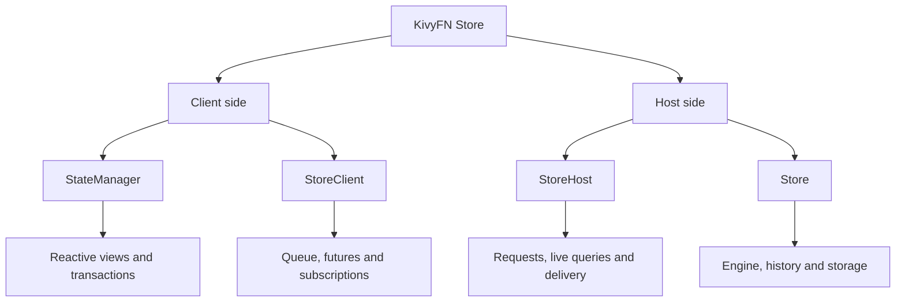
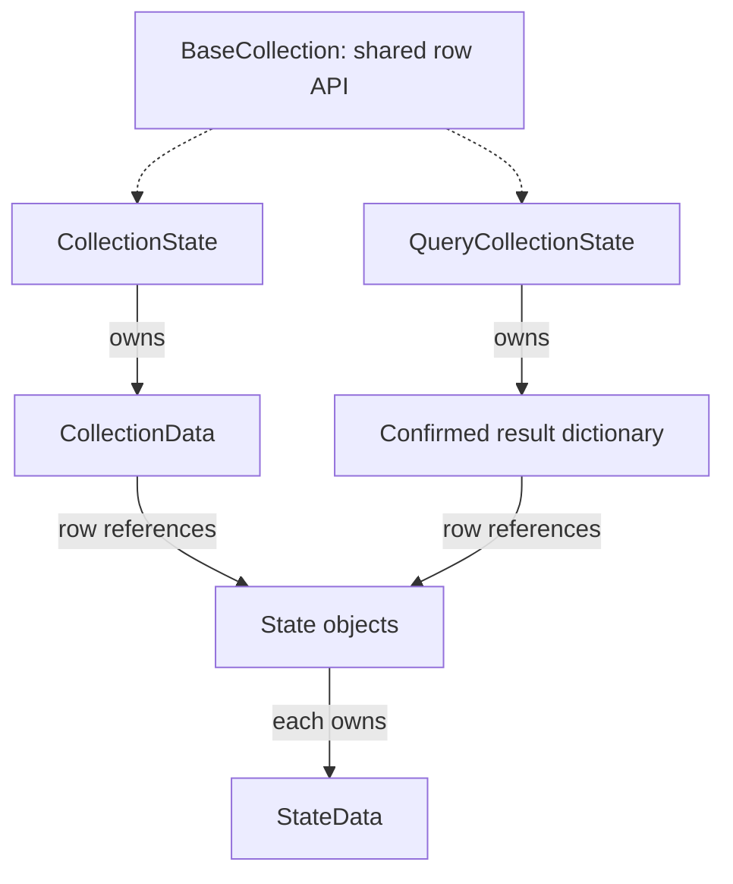
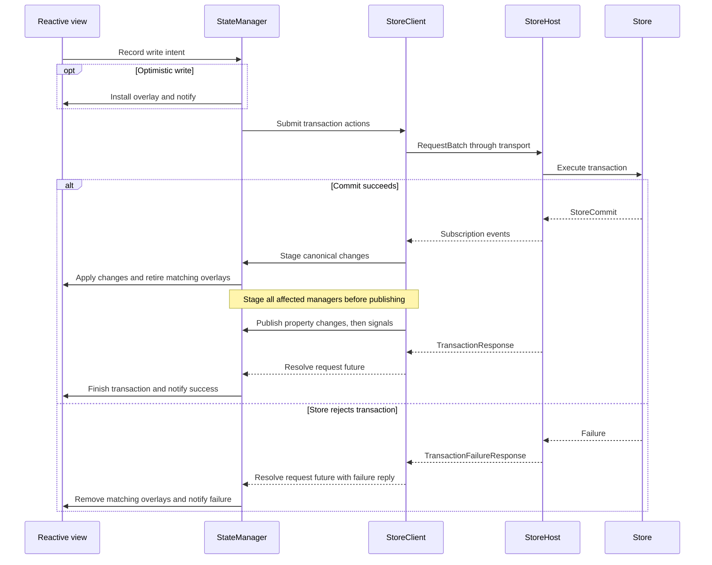

# KivyFN Store architecture

The **Store owns the confirmed truth**. Clients expose reactive views of that
truth. A local edit travels to the Store; committed changes travel back through
subscriptions.

**1. The main parts**

This tree groups responsibilities. The arrows describe the architecture;
the write diagram below shows the order in which the objects call each other.

| Start reading here | Responsibility |
| --- | --- |
| [StateManager](../src/kivyfn/store/state/manager.py) | Creates/reuses views through `StateRegistry`, coordinates writes and transaction completion, and routes host updates to views. |
| [StoreClient](../src/kivyfn/store/client/client.py) | Owns connection/reconnect, request batching, response validation, request futures, and subscription IDs/revisions. |
| [StoreHost](../src/kivyfn/store/host/host.py) | Exposes a Store, routes requests, manages subscribers and live queries, and sends ordered events to clients. |
| [Store](../src/kivyfn/store/store/store.py) | Executes atomic changes through `Engine`, tracks revisions/history, runs queries, and publishes commits. |

The supporting files have narrower jobs:

- `state/registry.py` preserves view/row identity; `reactive/factory.py` builds
  classes with the required Kivy properties. `StateTransaction` records actions
  and exposes the transaction's awaitable result.
- `client/queue.py` orders requests; `future.py` manages request waiters;
  `validation.py` checks reply types/IDs; `subscription.py` tracks subscriptions.
- `host/request.py` executes requests; `subscription.py` chooses recipients;
  `query.py` maintains shared live results; `client.py` owns delivery queues.
- `core/` prepares and validates mutations, including triggers and constraints.
  Nodes/indexes hold canonical records; `storage/` persists configured schemas.

All paths above are relative to `src/kivyfn/store/`. Schema declarations and
Builder configuration define the records, fields, relationships, and policies.

**The connection:** `StoreClient` and `StoreHost` communicate through Direct or
Socket.IO transports. Direct stays inside one process; Socket.IO can connect
separate processes or machines. Both use the protocol messages and codecs.
Requests, responses, and subscription events cross this boundary.

**2. What a reactive view owns**

Dotted arrows mean inheritance. Both containers expose `rows` as an observable,
read-only mapping to real State objects. `State` also represents a singleton.
The diagram shows types; each row has its own field data.

- **StateData:** confirmed field values plus pending transaction overlays.
- **CollectionData:** confirmed row references plus pending insert/remove
  overlays. An optimistic removal hides the row reference; its State survives.
- **QueryCollectionState:** membership comes from host query results. It has no
  collection overlays. Its individual State rows can still have field overlays;
  the manager maps writable projected fields back to their source records.

**Canonical** means host-confirmed data. An **overlay** is one pending
transaction's proposed change. **Visible** data combines canonical values with
the active overlays. Removing a failed overlay reveals the latest confirmed
values, including changes received while the transaction was pending.

Each State and editable CollectionState owns a `TransactionStatus` helper for
pending/success/failure events. Query containers have no transaction lifecycle.
A row stays `synced` while at least one confirmed owning collection is synced.

The view owns its data changes and notifications. The manager can call
`set_overlay()` or `apply_event()`; the view arranges publication itself.
`notification_batch()` delays callbacks until a compound update is readable.
Atomic storage changes are handled separately by the Store.

**3. Following one write**

Direct assignment, such as `row.enabled = True`, is optimistic. Explicit
methods such as `row.set(enabled=True)` show field changes when host updates
arrive. A `manager.transaction()` context groups recorded operations into one
transaction. Each Store transaction is atomic; a request batch carries an
ordered group of requests.

There are two completion objects: the **client request future** receives the
reply; the manager uses that reply to settle the **StateTransaction** and its
participants. Successful transaction completion follows canonical delivery.
Other subscribed clients receive the changes too; only the requester receives
that request's response.

For response batches, the client validates all replies, installs subscription
snapshots, drains buffered events, then resolves request futures. This preserves
the snapshot-before-updates order even when events arrive before a reply.

**4. Queries and subscriptions**

| Application call | Host work | Client result |
| --- | --- | --- |
| `client.query(query)` | Store evaluates the query once. | One response containing rows or a failure. |
| `manager.create(Schema)` | Host subscribes to that schema. | Initial snapshot, then updates to State or CollectionState. |
| `manager.create(query)` | Host retains a live query and its dependencies. | Initial result, then row/value changes in QueryCollectionState. |

Live queries are evaluated on the host. Equivalent subscriptions share a
`HostQuery`; a relevant commit reruns its plan and compares the old/new results.
The host sends the resulting changes to subscribers. The client keeps result
rows and projection metadata; the Store evaluates filters and joins.

On disconnect, unfinished request waiters fail and views become unsynced.
Reconnect obtains fresh subscription snapshots. Pending writes are not replayed.
A lost reply does not establish whether the host committed a write.

For deeper implementation detail, continue with [reactivity](reactivity.md)
or [architecture](architecture.md).

